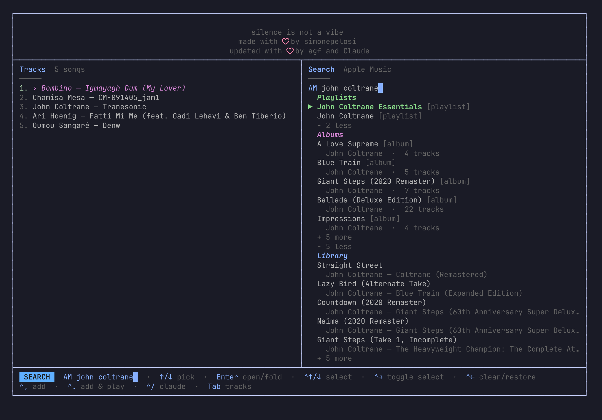
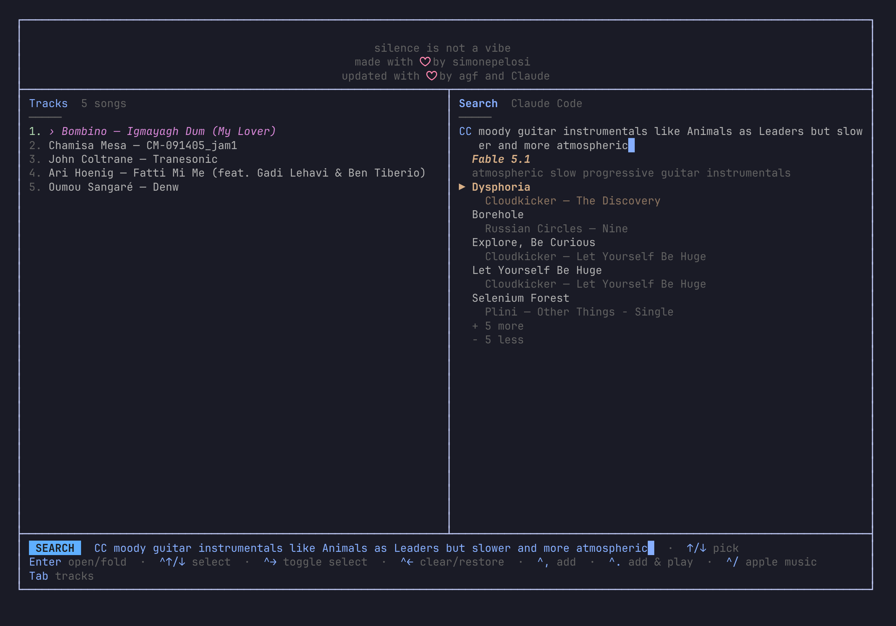
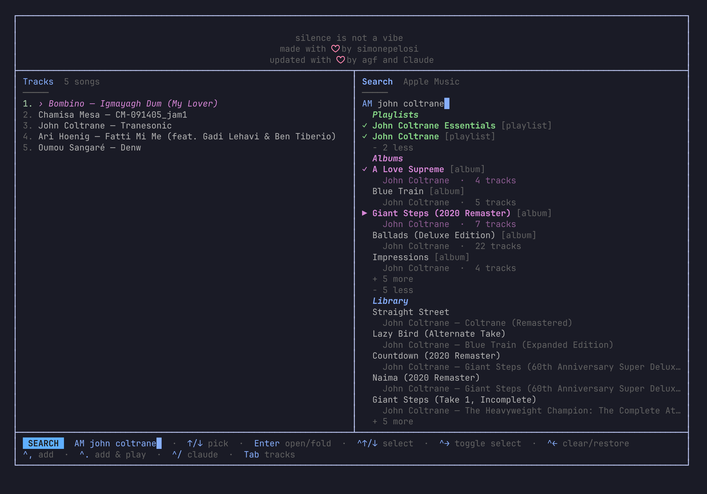

<p align="center">
  
</p>

<h1 align="center">♪ vibezAI</h1>

<p align="center">
  <strong>Apple Music in your terminal, with Claude Code as your DJ.</strong><br>
  A fork of <a href="https://github.com/simonepelosi/vibez">vibez</a> by Simone Pelosi.
</p>

<p align="center">
  <a href="https://github.com/angusforbes/vibezAI/blob/main/LICENSE"></a>
  <a href="https://github.com/simonepelosi/vibez"></a>
  <a href="https://github.com/angusforbes/vibezAI/blob/main/go.mod"></a>
</p>

[What it is](#what-it-is) · [Searching with Claude Code](#searching-with-claude-code) · [Saved lists](#saved-lists) · [Key bindings](#key-bindings) · [Installation](#installation) · [Configuration](#configuration) · [How it differs from vibez](#how-it-differs-from-vibez)

---

## What it is

vibezAI is a keyboard-driven Apple Music player for the terminal. Full tracks stream through a headless Chrome with Widevine, exactly as in vibez. What changed is the way you find and line up music: the screen is two columns, and the right one can hand your request to Claude Code.

<p align="center">
  
</p>

- **Tracks** (left) is the one list of what plays. It survives restarts, you move through it in place, and nothing you do in the right column ever replaces it.
- **Search** (right) has five sources, and `Ctrl+/` cycles them. `AM` searches Apple Music when you press `Enter`: Playlists, Albums, Library (your own copies) and Tracks, five per section, with `+ 5 more` / `− 5 less` rows and headers that fold. `AI` sends a plain-English description to the selected AI, Claude Code by default or ChatGPT through OpenAI's Codex CLI after `:ai gpt`, which plans the search and ranks the results. `AJ` uses the same Claude planner but reranks with [Jev](https://docs.typesafe.ai) (TypeSafe) instead of Claude — set `TYPESAFE_API_KEY` to compare it with `AI` side-by-side. `SV` lists the track lists kept with `:save`, the previous session's Tracks first, each a header that opens to all of its songs; add the whole list from its header or pick songs from it. `FE` shows Apple Music's recommendations for you, one section per group, albums and playlists to mark and add like any search hit.
- **Tab** moves the keys between the two columns. The column that has them shows its title in bold; the mode text next to "Search" glows while a lookup is running.
- Everything that works in a column is listed once, in the footer.

## Searching with Claude Code

Press `Ctrl+'` to jump to the Search prompt and start typing (`Ctrl+/` switches the prompt between `AM`, `AI`, and `AJ`). Type what you want to hear the way you would say it to a friend and press `Enter`.

<p align="center">
  
</p>

Two lookups from the day this was written, with the terms Claude came back with:

| You type | Claude's summary | Search terms it planned |
|---|---|---|
| `moody guitar instrumentals like Animals as Leaders but slower and more atmospheric` | Slow atmospheric progressive guitar instrumentals | Animals as Leaders · Plini instrumental · Intervals band · Chon · Polyphia slow songs · atmospheric post-rock instrumental |
| `dreamy 70s soul for a rainy sunday` | Dreamy 70s soul for rainy Sunday | Marvin Gaye I Want You · Minnie Riperton Perfect Angel · Isaac Hayes Hot Buttered Soul · Curtis Mayfield · Roberta Flack First Take · mellow 70s soul |

Other things that work well as prompts: an artist plus a direction ("early Radiohead but only the quiet songs"), an occasion ("brazilian jazz for cooking dinner"), an era and a feeling ("hopeful synth-pop from the mid 80s"), or a comparison ("bands that sound like Khruangbin but with vocals").

**What happens underneath**

1. **Plan.** The description goes to the Claude Code CLI (`claude -p`, no tools, no saved session) with a system prompt asking for four to six concrete Apple Music search terms: artists, songs, albums, at most two genre or mood phrases. It answers in JSON.
2. **Search.** Each term runs through the normal Apple Music search in parallel. Hits are interleaved term by term, deduplicated by artist and title, and pooled up to forty candidates.
3. **Rank.** The pool goes back to Claude with your description. It returns the best matches, up to fifteen, best first, favouring the mood, era and style you described and avoiding live, karaoke and tribute versions unless you asked for them.

The result appears as one section headed by the model that did the planning, with Claude's one-line summary under it. Everything in it is selectable and addable like any search result.

A lookup is two CLI calls, about seven seconds each with Fable 5.1 and roughly a cent in total; Sonnet is about twice as fast and a third of the price. `:model haiku` or `:model sonnet` switches, `:effort low` trims further, and both are remembered. When the CLI is unavailable, the built-in keyword table from vibez takes over and the header says so.

`:ai gpt` hands the same two steps to ChatGPT through OpenAI's Codex CLI (`codex exec`, your ChatGPT login, no API key), and the Search header says so. Each call carries Codex's own agent instructions, about 13k input tokens against your ChatGPT plan. `:model` and `:effort` then apply to ChatGPT, and `:ai cc` switches back. Only one AI is in charge at a time; AI radio (`A` in Tracks) uses the same one.

<p align="center">
  
</p>

Results, songs as well as whole albums and playlists, can be marked with `Ctrl+Shift+↑/↓` sweeps and `Ctrl+→` toggles and then added together with `Ctrl+,` or `Ctrl+.`.

## Saved lists

`:save road trip` keeps the Tracks panel as a list called "road trip". A bare `:save` names it for you, as in `2026-09-05_13-10_late night jazz`: the date and time, then two to four words Claude Code picks from the songs (without the CLI, the artist or genre that dominates them). Lists are plain files in `~/.config/vibez/tracklists/`, in the same format as `queue.json`, and the Tracks you had when you last quit are kept there too, as `last session`.

To use them, reach Search with `Tab` and press `Ctrl+/` until the prompt reads `SV`. Every list is a header with its size, `last session` first, then the newest saves. `→` opens one to all of its songs. `Ctrl+,` on the header adds the whole list to Tracks, on a song just that song, and `Ctrl+→` marks a header so a whole list joins a multi-selection. Adding never starts playback: with nothing playing, `space` starts what you have built. `Ctrl+Delete` on a header deletes the list, from disk and from the panel. Nothing here replaces Tracks; to start over from a list, clear Tracks with `c` first.

## Apple radio and AI radio

Two keys in Tracks keep the music going without a playlist, one song at a time. While either is on, every track that starts playing gets exactly one new song inserted directly after it, chosen once for that track and never again for the same track, so whatever you queued yourself is never pushed out, only spaced out. Turning one on also acts on the track playing right now. Both are quiet: the footer shows `● on` next to the key and what they did goes to the log (`:debug-logs`), not the status line. Turning one on switches the other off.

**Apple radio (`F`)** asks Apple Music, not an AI.

1. It fetches the Apple Music station of the playing track's catalog entry, the same list `R` draws five songs from.
2. Everything already in Tracks is dropped from that list, matched by id and by artist plus title, so a song you have listed cannot come back.
3. The first station song left is inserted right after the playing track.

Apple radio looks at nothing but the playing track: not the songs before it, and the rest of Tracks only as things to skip. A library-only track (your own upload or recording) has no catalog counterpart and so no station; it is skipped with a note in the log and the next track gets a pick instead.

**AI radio (`A`)** asks the AI in charge (Claude Code, or ChatGPT after `:ai gpt`) to act as a DJ. It is given three things:

1. **Now playing**: the artist, title and album of the playing track.
2. **The run before it**: up to ten tracks above the playing one in Tracks, oldest first, so it can follow the mood and the drift of what led here. Tracks below the playing one are not part of this context.
3. **Do not pick**: everything in Tracks, above and below, up to forty entries.

The prompt asks for three real, released songs, best first, that would follow the playing song well: matching its mood, era and style and the drift of the recent run, preferring a different artist from the last few songs unless the run is all one artist, never a live, karaoke or tribute version, and nothing from the do-not-pick list. vibezAI searches Apple Music for each pick in order and inserts the first hit whose title and artist match and that is not already in Tracks (checked by id and by artist plus title, whatever the AI was told). If none of the three exists on Apple Music, nothing is inserted for that track and the log says so. Each ask is one CLI call, given up to a minute; the AI sees only the text of those lists, never your library or Apple's station.

Neither looks at saved lists or Apple Music playlists, only at what is in Tracks at that moment.

## Album art

The Now Playing block at the top is four left-justified rows: "Artist — Title", "Album • elapsed / total", the transport icons and the status line. `:art` turns it into a card of eight rows with the cover at the very left and those rows beside it, and remembers the choice (`album_art` in the config).

Where the terminal draws sixel graphics, the cover is a real picture at the terminal's pixel resolution: vibezAI asks the terminal once at start (primary device attributes, `4` means sixel), reads the cell size in pixels, scales the 600 px cover to the eight-row square and draws it over the cells the card keeps blank for it. foot does this, and so does tmux 3.4 or newer when built with sixel support, which is how the picture survives tmux. Anywhere else the cover is coloured half-block characters, two pixels per cell, as in vibez. `VIBEZ_SIXEL=1` or `0` in the environment overrides the probe either way.

## Key bindings

### Tracks (left column)

| Key | Action |
|-----|--------|
| `space` | Play / pause |
| `↑` / `↓` | Move the highlight without changing playback |
| `enter` | Play the highlighted track; on the playing track, restart it |
| `q` | Put the highlight back on the playing track |
| `n` / `p` | Next / previous |
| `←` / `→` | Seek ±10 s |
| `d` | Remove the highlighted track |
| `D` / `ctrl+shift+d` | Cut everything from the highlight down / everything above it |
| `K` / `J`, `shift+←` / `shift+→` | Move the highlighted track up / down |
| `shift+↑` / `shift+↓` | Jump the highlight to the top / bottom |
| `R` | Insert five related songs after the highlighted track, once |
| `T` | Insert five random songs from your library after the highlighted track |
| `F` | Apple radio on / off: while on, each track that starts playing gets one song from its Apple Music station inserted right after it, once per track; see [Apple radio and AI radio](#apple-radio-and-ai-radio) |
| `A` | AI radio on / off: while on, the AI in charge (Claude Code, or ChatGPT after `:ai gpt`) picks one song to follow each track that starts playing, from that track and the ten before it; the pick is found on Apple Music and inserted right after it. Apple radio and AI radio switch each other off; see [Apple radio and AI radio](#apple-radio-and-ai-radio) |
| `s` | Jump to a random track |
| `S` | Shuffle Tracks and play from the top |
| `r` | Cycle repeat |
| `c` | Clear the list |
| `Tab` | Move the keys to Search |
| `ctrl+'` | Move the keys to Search and start typing into the `AM` or `AI` prompt |
| `:` | Command mode |
| `y` / `e` / `?` | Lyrics / equalizer / about; `Tab`, `esc` or the same key again closes the panel and returns to the column you came from. About takes no other keys but `ctrl+shift+d` (the original author's Ko-fi page) and `ctrl+shift+g` (this fork on GitHub), each opened in your browser |

### Search (right column)

| Key | Action |
|-----|--------|
| `ctrl+'` | Start or stop typing into the prompt (`AM` and `AI`); nothing is looked up while you type |
| `ctrl+/` | Cycle the source: `AM` → `AI` → `AJ` (Claude+Jev) → `SV` (saved lists) → `FE` (recommendations) → `AM`; text already typed is looked up when switching to `AI` or `AJ`, `AM` waits for `enter`; `SV` and `FE` take no text, so the typed text is hidden there and shows again with `AM`, `AI` or `AJ` |
| `enter` | While typing: search (`AM`) or look up (`AI`) the text and stop typing. Otherwise: play the track highlighted in Tracks |
| `space` | Play / pause (not while typing) |
| `→` / `ctrl+enter` | Open or fold a section header (a saved list opens whole), grow or shrink a section by five, or open an album or playlist to its tracks and fold it again |
| `ctrl+↑` / `ctrl+↓` | Move the highlight |
| `↑` / `↓` | Move the highlight in Tracks without leaving Search |
| `ctrl+shift+↑` / `ctrl+shift+↓` | Sweep-select: mark the highlighted item and everything passed over |
| `ctrl+→` | Toggle the highlighted item in or out of the selection; on an opened album or playlist its listed tracks go with it, and dropping one of them drops the collection's mark |
| `ctrl+←` | Clear the selection; pressed again before anything changes, bring it back |
| `ctrl+delete` | `SV`: delete the highlighted list, from disk and from the panel |
| `ctrl+,` | Add the selection, or the highlighted item, to Tracks; never starts playback (with nothing playing, `space` starts the list) |
| `ctrl+.` | The same, and start the first song |
| `Tab` / `esc` | Move the keys back to Tracks; while typing, `esc` only stops typing |

Albums and playlists are expanded to their songs when added. An item already in Tracks is never added twice; it is highlighted there instead.

The two columns share their keys: while nothing is being typed, every Tracks key works from Search (`s`, `n`/`p`, `d`, `c`, `R`, `T`, …) and every Search key works from Tracks (`ctrl+enter`, `ctrl+↑/↓`, `ctrl+shift+↑/↓`, `ctrl+→/←`, `ctrl+,`, `ctrl+.`, `ctrl+/`). Each footer lists only its own column's keys; `ctrl+'` is the one Search key the Tracks footer shows, as the way in.

### Command mode (`:`)

Typing `:` keeps both columns on screen and swaps the footer for the command list alone, each command with what it takes; type one and press `Enter`. `Tab` completes the first match, `esc` cancels.

| Command | Description |
|---------|-------------|
| `:ai <cc\|gpt>` | Which AI answers the `AI` source and AI radio: Claude Code (`cc`, default) or ChatGPT (`gpt`); bare `:ai` shows it |
| `:model <name\|default>` | Model the AI in charge uses (an alias like `haiku` or a full id; `default` leaves the CLI's own choice); bare `:model` shows it with the effort |
| `:effort <level\|default>` | Effort for the AI in charge (Claude: `low` … `max`; ChatGPT: `minimal` … `xhigh`); bare `:effort` shows it |
| `:save [name]` | Save Tracks as a named list in `~/.config/vibez/tracklists/`; the lists appear in Search under `SV`. Without a name the list is dated and named after its songs by Claude Code (from the artists and genres when the CLI is not there) |
| `:quality <high\|standard\|256\|64>` | AAC bitrate |
| `:debug-logs` | Toggle the debug log, where Claude's terms and rankings are recorded |
| `:art` | Album cover at the left of Now Playing on / off, remembered in the config; see [Album art](#album-art) |
| `:about` | About the app; it names this fork's repository |
| `:q` / `:quit` | Quit |

## Installation

vibezAI has no packaged releases; build it from source.

```bash
git clone https://github.com/angusforbes/vibezAI
cd vibezAI
PKG_CONFIG_PATH=$PWD/pkg-config go build -ldflags "-X 'github.com/simone-vibes/vibez/internal/version.Version=0.7.0+queue'" -o vibezAI .
install -m 555 vibezAI ~/.local/bin/vibezAI
vibezAI --no-update auth login      # Apple ID sign-in in a Chrome window
vibezAI --no-update                 # launch
```

**Requirements**

- Linux x86-64 (the setup this fork is developed on) · Go 1.26+ · WebKit/GStreamer development packages, or the `pkg-config` shim in the tree.
- An Apple Music subscription and a **MusicKit developer token** in `apple_developer_token` of `~/.config/vibez/config.json`. The upstream vibez releases embed the author's token; a build of this fork has none. Either build with your own key (`make build-with-token`, see upstream) or run the stock vibez release once, which writes its token to the config file.
- **A terminal that carries extended keys and sixel through tmux: [foot](https://codeberg.org/dnkl/foot)**, and **tmux** (3.4+, built with sixel). The player runs inside a tmux session (`scripts/vibez-toggle` opens it, so playback survives closing the window). Through tmux, foot passes on the keys that have no control code (`Ctrl+'`, `Ctrl+.`, `Ctrl+,`, `Ctrl+;`, `Ctrl+Shift+D/G`) and draws the cover as a real picture. kitty does neither through tmux: those keys arrive as plain `'` `.` `,` `;` and the cover shows tmux's "SIXEL IMAGE" placeholder. vibezAI checks the attached terminal at start (via `tmux display-message`) and says so in its status line when it's missing either; `vibez-toggle` refuses to start without tmux and falls back to the default terminal, with a notice, when foot isn't installed. Arch: `sudo pacman -S foot tmux`.
- For `AI` lookups and AI radio, [Claude Code](https://claude.com/claude-code) installed and logged in (`claude` on `PATH`), or OpenAI's Codex CLI (`codex`, logged in with ChatGPT) with `:ai gpt`. Without either, the `AI` prompt falls back to vibez's keyword table and AI radio has no one to ask.

Pass `--no-update`: the self-updater would replace this fork with the upstream release.

## Configuration

`~/.config/vibez/config.json` (the directory name is unchanged from vibez):

| Key | Meaning |
|-----|---------|
| `vibe_agent` | Which AI answers: `auto` (default: Claude when the CLI is installed, else keywords), `claude`, `chatgpt` (the Codex CLI) or `keywords`; `:ai` sets it |
| `vibe_model` | Model passed to the CLI. Empty means `claude-fable-5-1`; `default` leaves the CLI's own choice |
| `vibe_effort` | `low` … `max`; empty leaves the CLI's default |
| `ai_model` | Codex model slug for ChatGPT. Empty means `gpt-5.6-sol`; `default` leaves the CLI's own choice |
| `ai_effort` | `minimal` … `xhigh` for ChatGPT; empty leaves the CLI's default |
| `theme` | `default`, `dracula`, `gruvbox`, `nord`, or a custom theme in `~/.config/vibez/themes/<name>.json` |
| `audio_quality` | `high`/`256` (default) or `standard`/`64` |
| `album_art` | Album-art view on start |
| `wsl` | Audio workarounds for WSL2 |

Tracks are saved to `~/.config/vibez/queue.json` after every change and restored on the next start without auto-playing; at launch that list is also kept as the saved list `last session`. Named lists live in `~/.config/vibez/tracklists/`, one JSON file each.

## Search timings

Every AI (`AI` and `AJ`) vibe search appends one timing record to a local log file. The record captures only how long each stage took and whether the search succeeded — never the query text, song titles, album names, or any credential.

**Visible in the panel:** A compact summary line appears as a subtitle under the search results: `plan 1.2s · apple 3.4s · rank 0.8s · total 5.4s`. Stages that did not run (e.g. no reranking) are omitted.

**Timing file location:** `$XDG_STATE_HOME/vibezAI/search-timings.jsonl`, defaulting to `~/.local/state/vibezAI/search-timings.jsonl` when `XDG_STATE_HOME` is not set.

**File format:** One JSON object per line:
```json
{"ts":"2026-01-02T03:04:05Z","mode":"vibe","plan_ms":1200,"apple_ms":3400,"rank_ms":800,"total_ms":5400,"success":true}
```
Fields: `ts` (RFC 3339 timestamp), `mode` (`vibe` for the AI source, `aj` for the AJ source), `plan_ms` / `apple_ms` / `rank_ms` / `total_ms` (milliseconds per stage), `success` (false when the search produced an error). `rank_ms` is omitted when zero.

**Privacy:** The directory is created mode `0700` and the file mode `0600`; only the owning user can read it. You can inspect or delete it at any time; vibezAI does not read it back.

**Independent planning caveat:** Planning (AI call) and Apple Music searches are separate measured stages. The `plan` timer covers only the AI call; network latency to Claude Code or ChatGPT is included there. The `apple` timer covers the concurrent Apple Music requests plus any fallback search, measured as wall time (not the sum of concurrent requests). The two stages run sequentially, so `total ≈ plan + apple + rank + overhead`.

## How it differs from vibez

vibezAI started from vibez 0.7.0. The engines, themes, equalizer, Last.fm scrobbling and MPRIS integration are as upstream. The interface, the search and Apple radio are not, and upstream's continuous radio mode is gone.

| Area | vibez 0.7.0 | vibezAI |
|------|-------------|---------|
| Layout | Queue with a separate Queue panel, Library panel, Vibe panel and a header row | Two columns, Tracks and Search, and nothing else on screen; Now Playing is a left-justified card with the cover at the left, a real sixel picture where the terminal draws one |
| Queue | In memory only | Tracks persist to `queue.json`; navigated in place with `↑/↓`, `enter`, `d`, `D`, `K/J`; never replaced by a search; `:save` keeps named lists that Search offers under `SV` |
| Search | Single flat result list, `enter` plays and replaces the queue | Sections (Playlists, Albums, Library, Tracks) with `+ 5 more` / `− 5 less`, foldable headers, paging through Apple's results, duplicates never added |
| Vibe mode | `v` opens a prompt; a keyword table maps words to genres and dumps 15 shuffled songs into the queue | `AI` prompt inside Search; Claude Code (or ChatGPT) plans the terms and ranks a pool of 40 candidates; results shown as a section headed by the model, nothing added until you say so |
| Adding | `enter` plays, `tab` adds, `shift+tab` plays next | `ctrl+,` adds, `ctrl+.` adds and plays; multi-select with `ctrl+shift+↑/↓` and `ctrl+→`, albums and playlists included |
| Related songs | Continuous radio | `R` inserts five related songs once; `F` (Apple radio) and `A` (AI radio) add one song after each track that starts playing, from Apple's station or from the AI in charge; no continuous station mode |
| Library | Browser panel | `T` (shift+t) inserts five random library songs; the library is searched as part of every search |
| Feed | `F` opens a Feed panel | `FE` source in Search: the same sections, marks and adds as a search; `→` opens any album or playlist to its tracks, each addable on its own |
| Saved lists | — | `:save [name]` keeps Tracks as a list, named by Claude Code when no name is given; Search offers the lists under `SV`, whole or song by song; `ctrl+delete` removes one |
| Footer | Changes with the mode | One fixed list per column; `:` swaps it for the command list |
| Model choice | — | `:ai` picks Claude Code or ChatGPT; `:model` and `:effort` set the one in charge; config keys |
| Name | vibez | vibezAI (binary, MPRIS identity, splash and About) |

The Go module path is still `github.com/simone-vibes/vibez` so that upstream changes merge cleanly.

## Audio engines

| Engine | Tracks | How it works |
|--------|--------|--------------|
| **Chrome + Widevine** | Full tracks | Chrome via Playwright; MusicKit JS + Widevine DRM |
| **WebKit + GStreamer** *(Linux fallback)* | 30 s previews | Embedded webkit2gtk-4.1; GStreamer decodes preview URLs |

Chrome is downloaded once to `~/.cache/vibez/chrome`; the Playwright driver lives in `~/.cache/vibez/driver`.

## Architecture

```
vibezAI/
├── cmd/                    # CLI entry points (cobra)
├── internal/
│   ├── config/             # config.json, queue.json path
│   ├── auth/               # MusicKit OAuth flow
│   ├── provider/           # Provider interface + Apple Music (search, paging, stations)
│   ├── player/             # cdp (Chrome/Widevine), webkit, gst, mpris
│   ├── queuestate/         # Tracks persistence
│   ├── tui/
│   │   ├── model.go        # Bubble Tea model, key handling, footers
│   │   ├── find_panel.go   # Search column: prompts, wrapping input
│   │   ├── queue_*.go      # Tracks navigation, related songs, library picks
│   │   ├── tracklists.go   # :save, automatic names, the saved-lists source
│   │   └── views/          # search sections + multi-select, now playing, lyrics, about
│   └── vibe/               # Planner + Reranker: Claude Code CLI, keyword fallback
└── pkg-config/             # webkit2gtk shim for building on Arch
```

## Credits and license

vibez is © Simone Pelosi, MIT licensed; if you enjoy the player, consider [supporting the original project](https://ko-fi.com/pelpsi). The changes in this fork are by Angus Forbes and Claude, under the same MIT license.
